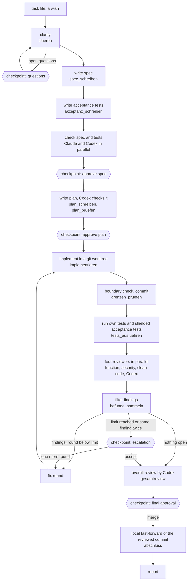
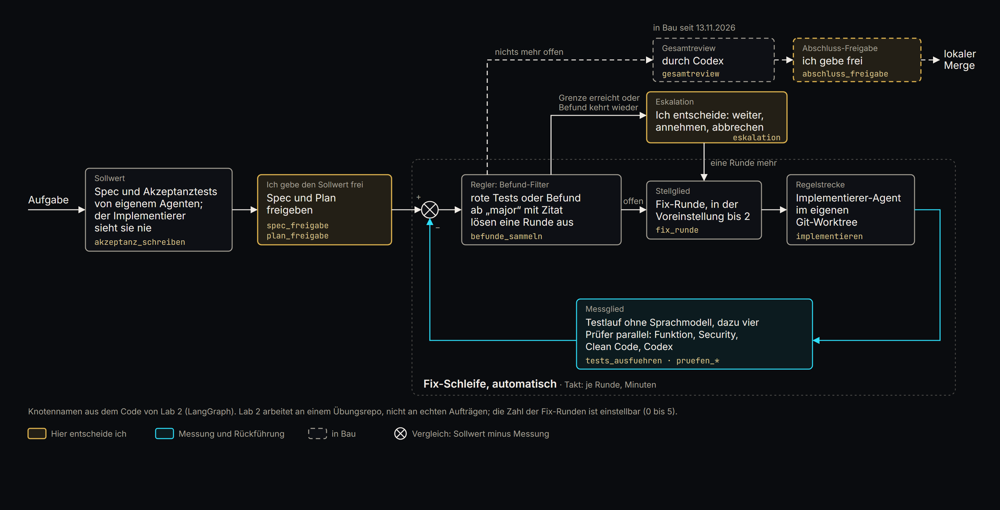

# langgraph-dev-pipeline

AI agents write code quickly. The hard part is knowing whether that code does what was asked. This repository is my
attempt to answer that with structure instead of trust: the software development flow for **one already scoped task**
runs as a [LangGraph](https://github.com/langchain-ai/langgraph) graph with real agents, and a human approves at fixed
checkpoints.

The flow is automatic: clarify the task, write a spec, write acceptance tests from it, plan, implement in an isolated
git worktree, check in parallel, fix, review the whole change and merge locally. I approve the spec, the plan and the
final merge, and I decide when the fix loop does not converge. No model approves its own work.

It is a learning project and a real pipeline at the same time. It worked on a small practice repository
(`examples/portwart`, a central list of local ports with a checker): the pipeline itself built its features A1 to A9.
A demo runs without any subscription.

> Deutsche Kurzfassung: [unten](#kurzfassung-auf-deutsch). The learning notes, plans and ledgers under `docs/` are in
> German, as are the task files and most identifiers.

## Quickstart (demo, no subscription)

Requires Python 3.12 and git. Tested on Windows 11.

```
git clone <this repo> && cd langgraph-dev-pipeline
python -m venv .venv
.venv\Scripts\python.exe -m pip install -r requirements.lock
.venv\Scripts\python.exe -m entwicklung demo
```

`demo` creates a fresh git repository from `examples/portwart` in a temp folder, starts the control room ("Leitstand")
on `127.0.0.1` and launches the demo task D1 ("count entries per project"). The agents are fakes with fixed answers.
Everything else is real: the graph, the boundary checks, the shielded acceptance tests, the finding filter, the
checkpoints and the fast-forward merge. Approve the spec, the plan and the merge in the browser and watch the nodes move.

Without a browser, the same run goes through all checkpoints automatically:

```
.venv\Scripts\python.exe -m entwicklung demo --durchlauf
```

On Linux or macOS use `.venv/bin/python` instead of `.venv\Scripts\python.exe`. I have not tested it there.

## The graph



This is a simplified view. The complete graph with all 32 nodes, as LangGraph generates it with
`get_graph().draw_mermaid()`, is in [`docs/graph.md`](docs/graph.md). Hexagons are checkpoints: the graph stops with
`interrupt`, stores its state in SQLite and continues later from the command line or the browser.

Read as a control loop, the fix loop has a setpoint (spec and acceptance tests, approved before the run), a
measurement on the result rather than on the agent's own report (test run without a language model, plus reviewers),
a limited intervention (at most two fix rounds by default, adjustable from 0 to 5) and an escalation to the human:



## Stations

| Station | What happens | Who |
|---|---|---|
| Clarify | An agent reads the wish and the repository and asks questions if the contract is still open. | Claude, read only |
| Spec | An agent writes the spec: goal, contract, scope, assumptions, and the interfaces the tests may import. | Claude, read only |
| Acceptance tests | A separate agent writes tests from the spec. Code checks them (imports only from the spec, at least one red against `main`). | Claude, read only |
| Spec review | Both model families check spec and tests against the wish; from the second version on, against the previous one. | Claude and Codex |
| Plan | An agent writes the implementation plan, Codex checks it against the spec. | Claude, Codex |
| Implement | The implementer works in its own git worktree on branch `lauf/<id>`. | `claude -p` |
| Test run | Own tests of the implementer, then the acceptance tests of this and all earlier tasks (regression). | no model |
| Reviewers | Function (counted from the test run), security, clean code and Codex, in parallel via LangGraph `Send`. | Claude, Codex |
| Fix loop | Triggering findings go back to the implementer, at most `--max-runden` times. | `claude -p` |
| Overall review | Codex judges spec, plan and diff as a whole and rates the "door" (see below). | Codex |
| Final approval | Merge or not. Only a local fast-forward, no push. | human |

All agents run as subprocesses of the `claude` and `codex` command line tools with a subscription; there are no API keys
in this code. Only the implementer may write, and only inside its worktree.

## Safeguards

**Shielded acceptance tests.** The implementer never sees the acceptance tests. They live outside the target repository
and are copied into the worktree only for the test run, then removed. They run with `--noconftest`, an empty pytest
configuration and a fixed root directory, so a `conftest.py` or `pytest.ini` written by the agent cannot deselect or
bend them. The expected number of tests is measured beforehand in an empty folder without any agent code. A skipped
acceptance test counts as not passed.

**Worktree boundary with a check afterwards.** Before and after every agent call, the pipeline records `git status`
(including file contents) of the target repository and of this project. Any change to their tracked or untracked files
ends the run with status `grenzverletzung` (boundary violation); files that were already git-ignored are not part of
this check. Files the agent hides in its worktree via `.gitignore` are caught. The generated tests are hashed when the
implementation starts and compared before and after every test run, because the implementer's own tests run first.

**Reviewers from two model families.** Spec, tests, plan and code come from the Claude family. Codex (GPT family)
reviews the spec, the plan, the implementation and the whole change. A Codex `major` finding is an objection: approving
anyway requires a written reason, which ends up in the report. Optional advisors at the checkpoints (one per model
family, only on request) raise objections the same way when they disagree.

**Findings must quote the code.** Every reviewer finding needs a location, a literal quote, a falsifiable claim and how
it was checked. A filter verifies the quote against the reviewed commit. Only findings with a verified quote and
severity `major` or higher trigger a fix round; a `major` from the clean code reviewer alone needs a second voice at the
same place.

**Convergence and escalation.** The fix loop has a hard limit. If the same finding comes back in two consecutive rounds,
the run stops early and asks me. Spec rounds use a stricter rule: from the second version on, reviewers check against
the previous version and say for each old point whether it is solved. Only unsolved old `major` points and new ones
caused by the change (or contradicting my answers) start another round; the rest goes on a list for me. A call budget (default 40 agent calls) pauses the run before spec, plan,
implementation and overall review once it is reached, and I decide whether to allow more.

**The door before the merge.** The final checkpoint shows a line `Tür: einseitig|zweiseitig · Radius: …`. "Two-way"
means the merge can be undone; "one-way" means the diff contains something that reaches beyond the repository or
destroys something (schema migration, deleting files or data, publishing, writing to a database, permissions and
secrets). The pipeline rates this itself with coarse patterns on the diff, Codex checks it independently, and the
stricter verdict wins. A one-way door is an objection, as are unexpected skipped tests.

**Merge only what was reviewed.** The merge is a fast-forward of exactly the commit that tests and the overall review
saw, and only if the target repository is still on the same branch, clean and has not moved on. Otherwise the status is
`merge_abgelehnt` (merge refused) and the branch stays.

**Control room on localhost only.** The browser UI binds to `127.0.0.1`, checks host and origin headers and accepts only
requests that carry the token created at start.

## Running it for real

You need the `claude` and `codex` CLIs, logged in with your own subscription. Then:

```
.venv\Scripts\python.exe -m entwicklung lauf --repo <path to a git repo> --aufgabe A10 --live
.venv\Scripts\python.exe -m entwicklung fortsetzen --entscheidung freigeben --live
.venv\Scripts\python.exe -m entwicklung leitstand
```

The task is a Markdown file `aufgaben/<repo>/<id>.md`. The target repository needs an `entwicklung.toml` with the
Python interpreter and the test command (see `examples/portwart/entwicklung.toml`). Run outputs go to `arbeit/`
(worktrees), `berichte/` (reports, spec, plan, generated tests) and `data/` (checkpoints); none of them are in git.
`HOW-TO-USE.md` (German) describes every checkpoint and command.

Machine-specific settings live in an optional, git-ignored `lokal.toml` or in environment variables: the path to an
external finding filter ([fusion-harness](#limits-and-open-points), not part of this repository) and folders the
pipeline must never write to. Without them a built-in filter is used: quote in the reviewed commit, file inside the diff,
severity.

## Tests

```
.venv\Scripts\python.exe -m pytest -q
```

On 2026-11-13 the suite had 574 tests: 573 passed and 1 was skipped (the drift check against fusion-harness, which
is not set up in a fresh clone), on Windows 11 with Python 3.12 in about 21 minutes. The tests never start a real agent (a test lock blocks the real implementer), use fake agents and mini
repositories in temporary folders, and check after each test that the real checkpoint database, report folder and
worktree folder are untouched.

## Limits and open points

- **One scoped task at a time.** Breaking a large project into such tasks happens before this pipeline and is not part
  of it.
- **Python and pytest only** for target repositories so far.
- **Windows first.** Developed and tested on Windows 11 with Python 3.12. On Windows, Codex cannot read files from its
  read-only sandbox, so diffs and source files are embedded in its prompts (cut to fixed limits).
- **No real sandbox.** The worktree boundary is checked afterwards, not enforced by the operating system. Test code of
  the implementer runs with my user rights; the checks catch changes in the protected repositories, not everywhere. A
  test timeout ends the test process, not processes it may have started. Agents and their test code see the
  environment variables of the pipeline (only the Anthropic keys are removed for test runs), so run it in an
  environment without unrelated secrets.
- **Stage 7 (overall review, final approval, merge) is new.** It is tested with fakes and in the demo; the first run on
  a real task is still open.
- **Stage 6d:** convergence like in the spec rounds also for plan rounds and the fix loop.
- **fusion-harness** is my own external finding filter. It is optional here and not published; the built-in filter does
  not detect speculative findings.
- Next steps beyond that: the upstream decomposition of larger projects into tasks, and other languages and test tools.

## Repository layout

```
entwicklung/        the package: graph (graph.py, graph_s4.py), agents, reviewers, filter, test run, CLI, control room
tests/              the test suite (fakes, temporary folders)
aufgaben/portwart/  tasks A1–A9 and their acceptance tests, as the pipeline produced and accepted them
examples/portwart/  the practice repository after A9, for the demo
docs/lernpfad/      one learning note per stage (German)
docs/superpowers/   plan and ledger per stage (German): decisions, rulings, review findings and fixes
docs/specs/         the original design
```

## Kurzfassung auf Deutsch

Lab 2 bildet den Softwareentwicklungs-Ablauf für eine einzelne, schon zugeschnittene Aufgabe als LangGraph-Graph ab:
klären, Spec, Akzeptanztests, Plan, Umsetzung im Git-Worktree, parallele Prüfungen, Fix-Schleife, Gesamtreview und
lokaler Merge. Der Ablauf läuft automatisch; ich gebe an festen Haltepunkten frei (Spec, Plan, Abschluss) und
entscheide, wenn die Fix-Schleife nicht konvergiert. Vertrauen entsteht über die Mechanik: Der Implementierer sieht die
Akzeptanztests nie, eine Nachkontrolle bemerkt jede Änderung außerhalb seines Worktrees, Prüfer aus zwei Modellfamilien
müssen ihre Befunde mit einem Zitat belegen, und kein Modell gibt sich selbst frei. Die Demo läuft ohne Abo
(`python -m entwicklung demo`). Lernnotizen, Pläne und Ledger unter `docs/` sind deutsch.

## License

MIT, see [LICENSE](LICENSE).
